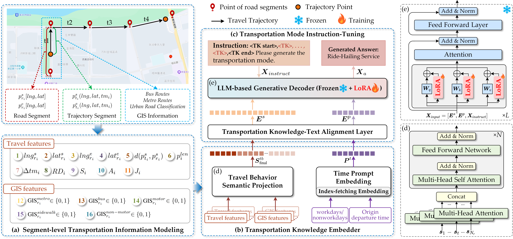
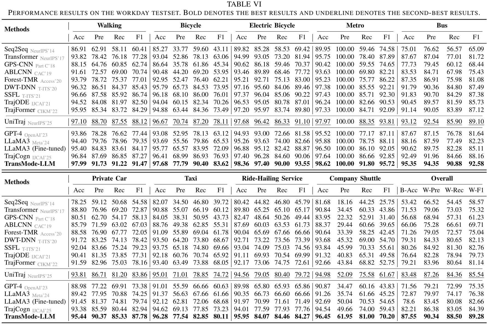
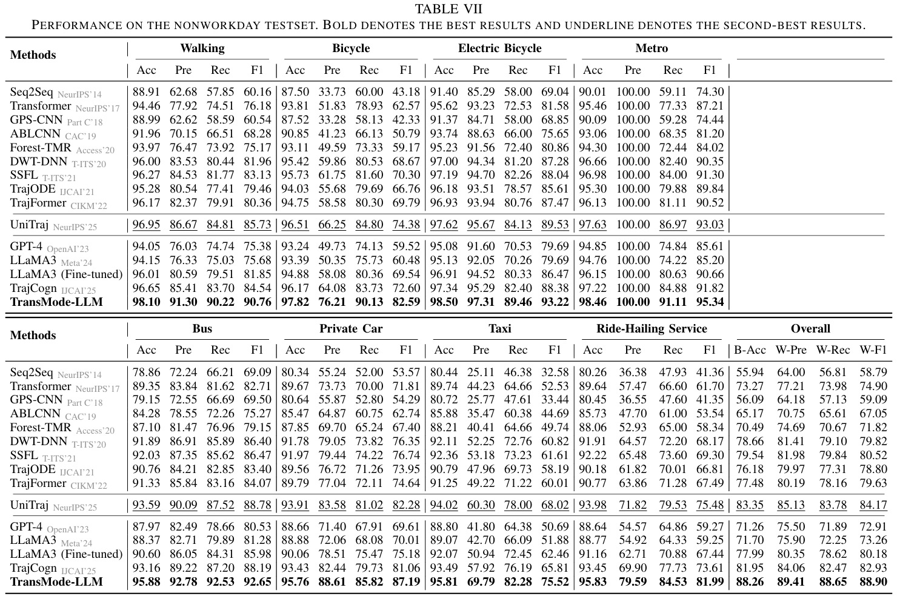
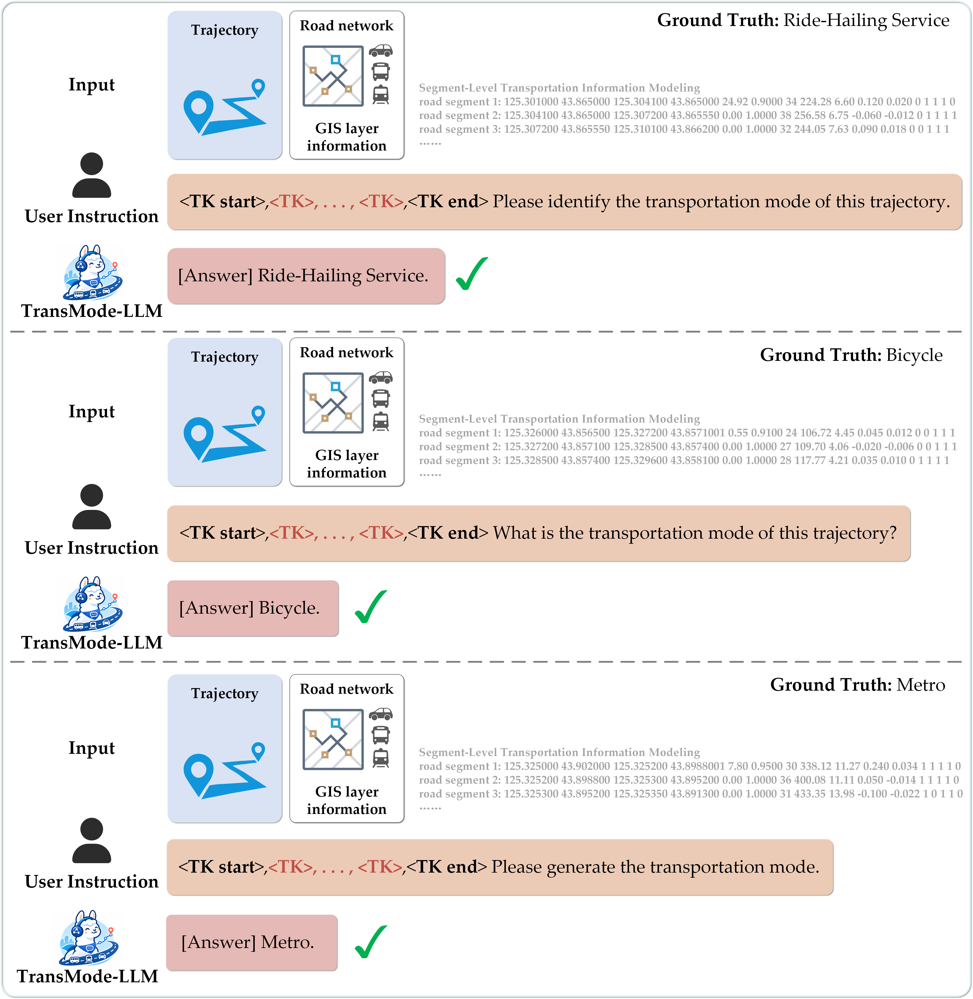

# TransMode-LLM: Knowledge-Infused LLM Adaptation toward Individual Transportation Modes Recognition in GPS Trajectories
<p align="center">
    
</p>


<div align="center">
<strong>Author: Yang Zhan, Haowen Xiang, Yan Li, Yu Zhang, and Zehao Yuan </strong>

<strong>School of Artificial Intelligence, OPtics, and ElectroNics (iOPEN), Northwestern Polytechnical University</strong>

<strong> State Key Laboratory of Maritime Technology and Safety, Wuhan University of Technology </strong>

<strong> Intelligent Transportation Systems Research Center, Wuhan University of Technology </strong>

<strong> School of Transportation and Logistics Engineering, Wuhan University of Technology </strong>

<strong>State Key Laboratory of Information Engineering in Surveying, Mapping and Remote Sensing, Wuhan University </strong>

<strong>Institute of AI for Industries, Chinese Academy of Sciences </strong>


</div>

This is the official repository for paper **"TransMode-LLM: Knowledge-Infused LLM Adaptation toward Individual Transportation Modes Recognition in GPS Trajectories"**.


## Please share a <font color='orange'>STAR ⭐</font> if this project does help


## 📢 Latest Updates
This is an ongoing project. We will be working on improving it.
- 📦 Codebase and model inference tutorial coming soon! 🚀
---


## 🌋 HumMob-ChCh Dataset

<div align="center">
  
</div>
<div align="center">
  
</div>
<div align="center">
  
</div>

## 🚀 TransMode-LLM Model

<div align="center">
  
</div>


## 📦 Performance
<div align="center">
  
</div>
<div align="center">
  
</div>

## 👁️ Visualization
<div align="center">
  
</div>


## 📜Reference
If you found this code useful, please cite the paper. Welcome :+1:_<big>`Fork and Star`</big>_:+1:, then I will let you know when we update.
```
@inproceedings{zhandoes,
  author={Yang Zhan, Haowen Xiang, Yan Li, Yu Zhang, and Zehao Yuan},
  title={TransMode-LLM: Knowledge-Infused LLM Adaptation toward Individual Transportation Modes Recognition in GPS Trajectories},
  year={2026}
  }
```


## 🤖 Contact
If you have any questions about this project, please feel free to contact zhanyangnwpu@gmail.com.


